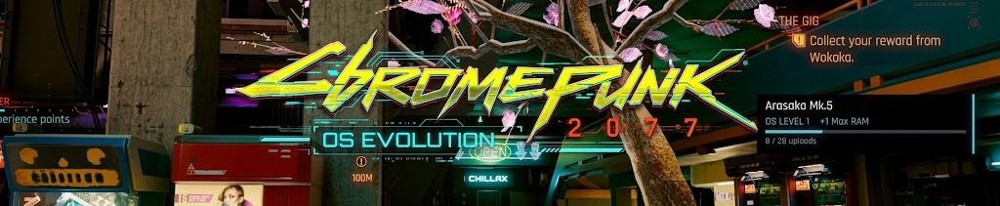
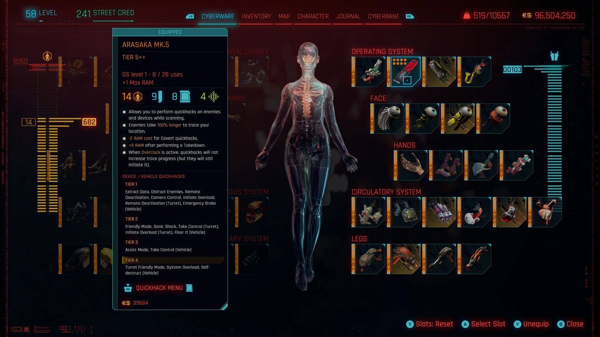
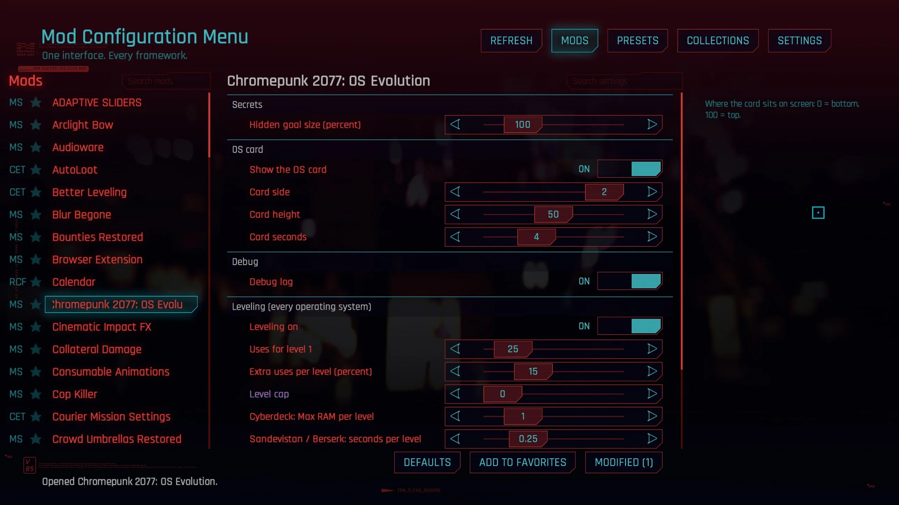
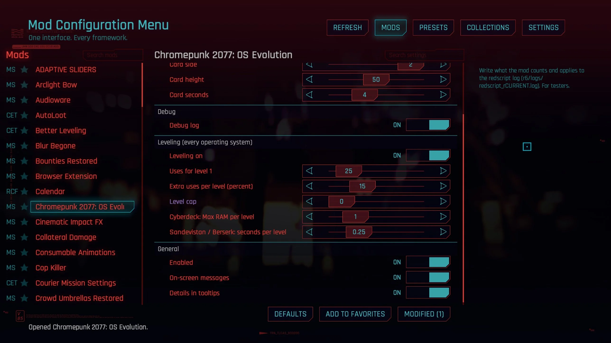
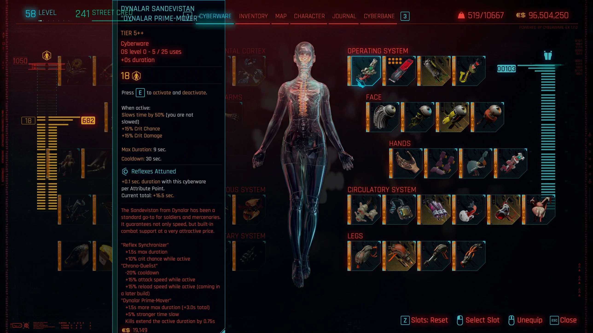

# Chromepunk 2077: OS Evolution

*Your operating system learns from how you fight.*

A progression mod for Cyberpunk 2077 2.x with Phantom Liberty: cyberdecks, Sandevistans and Berserks level up as you use them, and the sixteen Tier 5++ models evolve through three stages with titles and perks of their own. A companion to [Weaponpunk 2077](https://github.com/allykatz1990/Weaponpunk2077).

**Status: public beta, v0.5 (initial release).** Back up your saves.

## Features

- **Every operating system levels up**, every tier, modded ones too. Levels are per model (all tiers of a deck share one level), the same way Weaponpunk keys weapons.
  - Cyberdecks count finished quickhack uploads; Sandevistans and Berserks count activations.
  - Each level gives **+1 Max RAM** (decks) or **+0.25s duration** (Sandevistans, Berserks).
  - The first level takes 25 uses, each next level 15% more, up to level 20. All of it is a setting.
- **Something more for the best chrome.** Push a Tier 5++ operating system far enough, in the way it was built to be used, and it may earn something of its own. Nothing tells you what or when. (Spoilers: `SPOILERS.md`.)
- **OS card** when you activate a Sandevistan or Berserk or finish a quickhack upload: level, uses, and a highlighted line on a level-up. Right edge by default, clear of Weaponpunk's weapon card.
- **Tooltip** (Cyberware screen and inventory) with the level, its uses and its bonus.
- **CyberwareEx supported:** with more than one operating system equipped, every one of them counts and levels.
- Everything is configurable in Mod Settings.

## Screenshots

The OS card after a quickhack upload: level, its bonus, and progress to the next level. Side, height and how long it stays are settings.

| | |
|---|---|
|  Cyberware screen tooltip: the OS level and its uses, with the bonus on the line below. |  Mod Settings (shown in Mod Configuration Menu): OS card, debug log, leveling. |
|  Leveling (uses per level, growth, cap, bonus per level) and general switches. | |

<b>⚠ Spoiler screenshots: they show the hidden system. Click only if you don't want to discover it yourself.</b>

## Requirements

- Cyberpunk 2077 2.x with Phantom Liberty (Tier 5++ items need it)
- [redscript](https://www.nexusmods.com/cyberpunk2077/mods/1511)
- [Codeware](https://www.nexusmods.com/cyberpunk2077/mods/7780) (draws the OS card)
- [Mod Settings](https://www.nexusmods.com/cyberpunk2077/mods/4885) (optional, needed to change any setting; works in the Mod Configuration Menu too)

No REDmod, no TweakXL.

## Compatibility

- **Weaponpunk 2077:** made to run alongside it. Both wrap the same tooltip and damage functions without replacing them.
- **Sandevistan Customization – Time Dilation** (Tier 5+ and Tier 5++ All in One): compatible. That mod rewrites the Sandevistan's own stats; this one adds separate bonuses on top. Whatever you set there, Chromepunk's duration and cooldown bonuses are added to it.
- **Quickhacks Boost:** compatible. It edits the quickhack records themselves (costs, upload times, spreading, RAM regen); Chromepunk adjusts the final cost and upload time the game works out from them, and adds its own stat bonuses on top. Both apply.
- **CyberwareEx:** supported (see above).

## Installing

Copy the `r6` folder from the archive into your Cyberpunk 2077 game folder, so the files end up in `Cyberpunk 2077\r6\scripts\ChromepunkOSEvo\`.

## Removing

Delete `r6\scripts\ChromepunkOSEvo\`. Saves still load; all bonuses disappear with the mod.

## For developers

- `data/cyberware_5plusplus_titles.csv` is the single source of truth for stages, titles, goals and perks. Its `effects` column says what each perk does; the mini-language is documented at the top of `tools/gen_osevo.py`.
- After editing the CSV, run `python3 tools/gen_osevo.py`. It rewrites `r6/scripts/ChromepunkOSEvo/OSEvoData.reds`. Never edit that file by hand.
- Perks marked `later` in the CSV show in the tooltip as "coming in a later build".
- The title system is meant to stay hidden from players: keep its details out of the README and Nexus text. They live in `SPOILERS.md`, which `tools/gen_osevo.py` rewrites from the CSV.
- Console checks (Cyber Engine Tweaks) are listed at the top of `OSEvoSystem.reds`.
- **Debug log location:** the mod logs through Codeware's `ModLog`, which goes to Cyber Engine Tweaks'
  `bin\x64\plugins\cyber_engine_tweaks\gamelog.log` (search for `ChromepunkOSEvo`), not to
  `r6\logs\redscript_rCURRENT.log` (that one only shows whether the scripts compiled).

## License

GPL-3.0-or-later. The source stays open, as with Weaponpunk.
